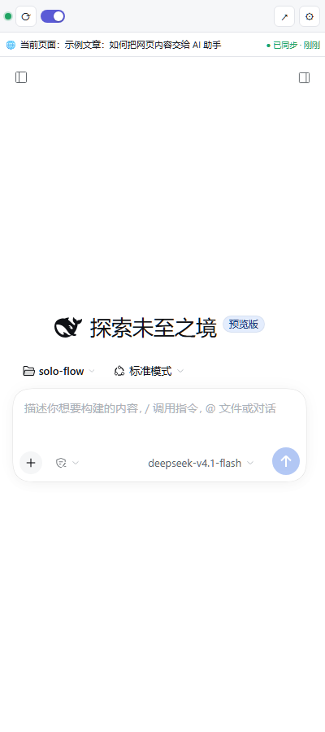
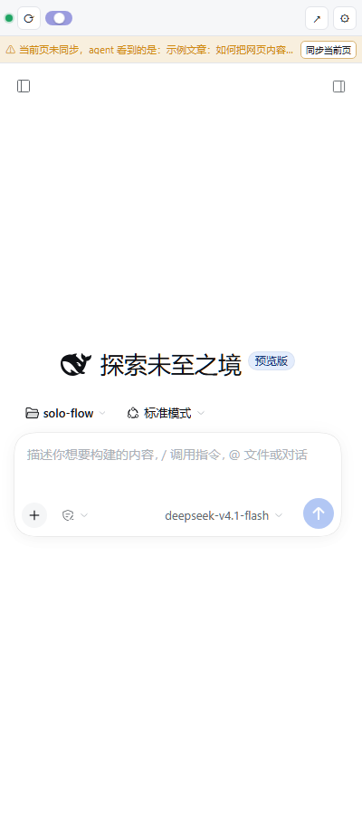

# DSH Browser Sidebar

把 **DeepSeek Harness（DSH）** 内嵌成 Chrome 侧边栏，并把**你当前网页的正文 / 选中文本 / 元数据**和**视频字幕**（YouTube、哔哩哔哩）同步给 DSH 的 agent —— 在侧边栏里问「这页讲了什么」「这个视频讲了什么」，它自己调工具读取。

> Chrome 侧边栏扩展（MV3）+ 一个 DSH Host 插件。侧边栏里就是**官方 DSH Web UI**（会话、工具调用、轨迹、模型选择全都在），不是另做的聊天框。

[](#)
[](LICENSE)
[](https://github.com/Trouvaille-xx/dsh-browser-sidebar/actions/workflows/tests.yml)





## 特性

- **官方 UI 内嵌**：侧边栏 iframe 加载 DSH Web UI（经本机反向代理注入鉴权，浏览器侧不需要任何 cookie 技巧）。
- **按需读取页面上下文**：DSH agent 通过 `browser_page` 工具读取快照，避免每轮都把整页塞进 prompt。
- **视频字幕**：
  - YouTube：从 `ytInitialPlayerResponse` 取 caption tracks → 拉 timedtext（XML/JSON3），含滚动式字幕合并；
  - 哔哩哔哩：登录态优先读页面 `__INITIAL_STATE__.videoData.subtitle.list`，兜底 `player/v2`（带 cookie）选轨，再退化到页面文字；
  - 通用 `<video>`：读 `textTracks` cues。
- **「当前页面」状态条**：随时显示 harness 认为你在看哪一页；切页未同步时给出黄色警告 + 一键同步，读取失败时把原因挂在状态条上（不再一闪而过）。
- **自动同步**：切页 / SPA 路由变化 / 内容变化自动推送（可关），同一内容去重，只更新「当前标签页」。
- **隐私**：只读你主动激活的标签页，不读密码框和输入内容，快照只存在本机 DSH 进程内存 + 浏览器会话存储。

## 架构

```
┌──────────── Chrome ─────────────┐
│ 侧边栏 (chrome-extension://)     │
│  ├─ 工具条 + 当前页面状态条       │
│  └─ iframe → 127.0.0.1:41789 ───┼─┐
│ 内容脚本：正文/选中/视频字幕抽取   │ │ ① 页面快照 POST /__bridge/context
└─────────────────────────────────┘ │
                                     ▼
┌───────── DSH 宿主进程（桌面应用 / dsh web）─────────┐
│ dsh-browser-sidecar 插件                            │
│  ├─ 反向代理 :41789 → DSH Web UI（服务端注入鉴权）   │
│  ├─ /__bridge/* 上下文仓库（内存，50 tab LRU）       │
│  └─ browser_page 工具 + ≤5 行系统提示               │
└─────────────────────────────────────────────────────┘
```

为什么需要代理：DSH 的 Web 鉴权 cookie 是 `HttpOnly; SameSite=Strict`，跨站 iframe 天然带不过去；插件在服务端完成 token → cookie 交换，浏览器只访问代理（同源、无鉴权负担）。

## 目录

```
extension/                     Chrome MV3 扩展（零构建，直接「加载已解压」）
  sidepanel.*                  侧边栏：工具条 + 状态条 + DSH iframe
  content.js  background.js    页面抽取 / 标签页事件 / 字幕抓取 / 上报
  lib/core.js  lib/net.js      共享纯函数（可单测）+ 带超时 fetch
  test/                        133 个 node:test 用例
packages/dsh-browser-sidecar/  DSH Host 插件（反代 + bridge API + 工具）
  proxy.js bridge.js tools.js core.js context-store.js
  test/                        51 个用例（含 mock 上游、SSE、WebSocket、401 自愈）
scripts/                       install-sidecar / pack-extension / sign-crx
docs/                          安装使用、架构规格、插件实现与排错
```

## 安装

前置：本机已安装 DSH 桌面应用（或可运行 `dsh web`），Chrome ≥ 116。

### 1. 装 DSH 桥接插件

```powershell
# 先完全退出 DSH 桌面应用（托盘 → 退出）
cd <本仓库目录>
node scripts/install-sidecar.mjs --dry-run   # 只看计划
node scripts/install-sidecar.mjs             # 装进 desktop profile（自动备份 + 回滚说明）
```

重启桌面应用，然后验证：

```powershell
curl.exe -s http://127.0.0.1:41789/__bridge/health
# {"ok":true,...,"upstream":{"ok":true,...,"authReady":true},...}
```

浏览器直接打开 <http://127.0.0.1:41789/> 应看到 DSH Web UI（不是 401）。

> sidecar 固定监听 `127.0.0.1:41789`；上游 Web UI 端口由插件从宿主自动发现（DSH 桌面应用用 `--port 0`，端口每次随机）。

### 2. 装 Chrome 扩展

1. 打开 `chrome://extensions` → 右上角开启「开发者模式」。
2. 「加载已解压的扩展程序」→ 选择本仓库的 `extension/` 目录。
3. 建议把扩展固定到工具栏，点图标即可打开侧边栏。

> 也可以解压 [Releases](https://github.com/Trouvaille-xx/dsh-browser-sidebar/releases) 里的 zip 后加载。

## 使用

1. 打开任意网页，点扩展图标 → 侧边栏打开；顶部工具条下方是「当前页面」状态条：
   - 绿色 `● 已同步 · 12 秒前`：agent 看到的就是这页；
   - 黄色 `⚠ 当前页未同步，agent 看到的是：<旧标题>`：点 **[同步当前页]**；
   - `⚠ 读取失败：<原因>`：按提示处理（页面未加载完 / 扩展刚刷新过需要重开侧边栏等）。
2. 在侧边栏的 DSH UI 里直接提问：
   - 「总结我当前页面的要点，用 5 条」
   - 「这个视频讲了什么？按字幕时间线列大纲」
   - 「把选中的这段翻译成英文」
3. agent 会先调 `browser_page(mode="summary")` 判断有没有上下文，再按需取正文/字幕。

`browser_page` 的 5 个模式：`summary`（默认）/ `page` / `selection` / `video` / `transcript`，可选 `tabId`、`maxChars`。

## 模型与账号

侧边栏里的模型来自**它所连接的那个 DSH 进程**。把插件装进 `desktop` profile 后，侧边栏就是你日常那个 DSH：模型、账号、插件、技能天然一致。

如果用隔离 profile 试跑（例如 `sidebar-test`），需要把 `desktop` profile 里的 `llm-pi-ai` 配置段复制过去，模型列表才会一致（详见 [安装使用文档](docs/browser-sidebar-usage.md)）。

## 隐私与安全

- sidecar 只绑定 `127.0.0.1`，不提供任何文件读写 / 命令执行接口；唯一能力是代理 DSH UI 与接收页面快照。
- `/__bridge/*` 的 CORS 只回显 `chrome-extension://` 与 loopback 来源；其它网页 Origin 一律 403。
- 代理注入的鉴权 cookie 来自 DSH 进程内 `connection.authenticatedUrl()`（官方 API），**不读取** `.credentials.yaml`。
- 快照只存内存（v1 不落盘），DSH 重启即清空；扩展侧只写 `chrome.storage.session`。
- 信任边界与 DSH 自身一致：本机任意进程可访问 41789，**不要把该端口转发到局域网/公网**。

## 开发与测试

```powershell
# 全部测试（扩展 133 / 插件 51）
node --test extension/test/*.test.mjs
node --test packages/dsh-browser-sidecar/test/*.test.js
# 若在受限环境（管道 spawn 被拒）：加 --test-isolation=none

# 扩展 + mock bridge 联调（不装插件、不起 DSH）
node extension/test/mock-bridge.mjs --port 41800
node extension/test/verify-bridge.mjs --bridge http://127.0.0.1:41800 --tab-id 777

# 打包
node scripts/pack-extension.mjs        # dist/dsh-sidebar-<version>.zip
node scripts/sign-crx.mjs              # dist/dsh-sidebar-<version>.crx（可选，本地 key）
```

更多： [安装与使用](docs/browser-sidebar-usage.md) · [架构规格](docs/browser-sidebar-spec.md) · [插件实现与排错](docs/browser-sidecar-plugin.md)

## 已知限制

- B 站 CC / AI 字幕需要登录态；未登录时只能读到视频页文字（会明确标注 `transcriptSource`）。
- 不支持：抽帧看画面、音频转写、DRM 视频（Netflix 等）。
- YouTube / B 站页面结构改版可能让字幕抓取退化为页面文字。
- 同一时间只能有一个进程监听 41789（多 profile 同时跑需要改端口并同步改扩展设置）。
- `.crx` 仅作企业策略分发备用；Chrome 不允许双击安装店外 crx，常规分发用「加载已解压」或 zip。

## License

[MIT](LICENSE)

---

### English

A Chrome side-panel extension that embeds the official DeepSeek Harness (DSH) Web UI and feeds the current page's text, selection and video transcripts (YouTube / Bilibili) to the DSH agent through a small host plugin.

- **extension/** — MV3 side panel (toolbar + page indicator + DSH iframe), content script, background worker.
- **packages/dsh-browser-sidecar** — DSH host plugin: loopback reverse proxy (`41789 →` DSH Web UI, auth injected server-side), `/__bridge/*` context API, `browser_page` tool.

Install: run `node scripts/install-sidecar.mjs` with the DSH app closed, restart it, then load `extension/` in `chrome://extensions` (Developer mode). See [docs/browser-sidebar-usage.md](docs/browser-sidebar-usage.md).
