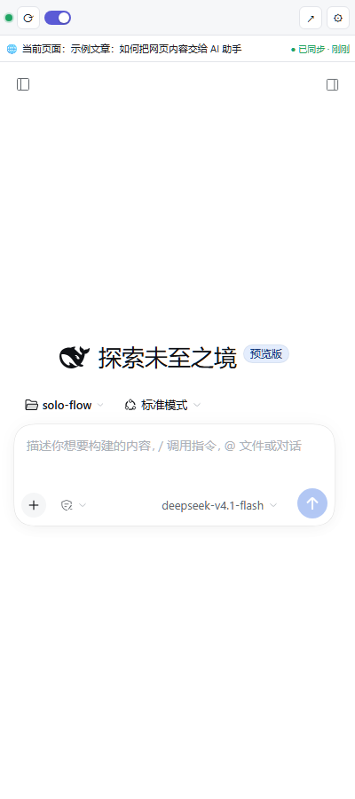

# DSH 浏览器侧边栏助手 — 安装与使用

> 在 Chrome 侧边栏里内嵌 DeepSeek Harness 官方 Web UI，并把**你当前网页的正文/选中文本/元数据**和**视频字幕/视频页文字**同步给 DSH 的 agent：你在侧边栏里问「这页讲了什么」「这个视频讲了什么」，它自己调 `browser_page` 工具读取。



---

## 0. 它是怎么工作的（30 秒版）

```
┌──────────── Chrome ────────────┐
│ 侧边栏 (chrome-extension://)   │
│  ├─ 顶部工具条（状态/读取/设置）│
│  └─ iframe → 127.0.0.1:41789   │──┐
│ 内容脚本：抽取正文/选中/视频字幕 │  │  ① 页面快照 POST /__bridge/context
└────────────────────────────────┘  │
                                    ▼
┌────────── DSH 宿主进程（你的桌面应用）──────────┐
│ dsh-browser-sidecar 插件                        │
│  ├─ 反向代理 :41789 → DSH Web UI（服务端注入鉴权）│
│  ├─ /__bridge/* 上下文仓库                      │
│  └─ 工具 browser_page + 系统提示片段            │
└─────────────────────────────────────────────────┘
```

- **iframe 不用碰浏览器 cookie**：DSH 的 Web 鉴权 cookie 是 `SameSite=Strict`，跨站 iframe 天然带不过去；所以由插件在**服务端**完成 token → cookie 交换，浏览器只访问代理（同源、无鉴权负担）。这条链路已实测跑通（见 §10）。
- **DSH 里的对话就是原生体验**：你看到的就是官方 UI（会话、工具调用、轨迹、模型选择、审批全都在），不是另做的聊天框。
- **上下文按需读取**：agent 通过 `browser_page` 工具拿快照，避免每次把整页塞进 prompt。

---

## 1. 目录

| 路径 | 作用 |
| --- | --- |
| `extension/` | Chrome MV3 扩展（零构建，直接「加载已解压」） |
| `packages/dsh-browser-sidecar/` | DSH Host 插件：反代 + `/__bridge/*` + `browser_page` 工具 + 系统提示 |
| `scripts/install-sidecar.mjs` | 把插件装进指定 profile（自动备份 + 校验 + 回滚说明） |
| `scripts/pack-extension.mjs` | 打包 `dist/dsh-sidebar-1.0.0.zip`（含 CRC 自检） |
| `scripts/sign-crx.mjs` | 可选：用本地 key 生成 `.crx`（固定扩展 ID） |
| `docs/browser-sidebar-spec.md` | 架构与验收规格 |
| `docs/browser-sidecar-plugin.md` | 插件实现细节与排错（反代/鉴权/配置） |
| `docs/browser-bridge-recon.md` | DSH 0.2.2 逆向调研（鉴权、iframe、工具、安装） |

---

## 2. 安装（两步，约 3 分钟）

### 2.1 装 DSH 桥接插件

前置：**完全退出 DSH 桌面应用**（托盘 → 退出，不是关窗口）。桌面应用运行时独占 profile，pnpm 写入会冲突。

```powershell
cd <本仓库目录>

# 只打印计划，不写任何东西
node scripts/install-sidecar.mjs --dry-run

# 正式装进 desktop profile（自动备份 package.json / cordis.patch.yml 到
# <profile>\.sidecar-backup-<时间戳>\，并生成 RESTORE.md）
node scripts/install-sidecar.mjs
```

> **用的是 DSH 桌面应用？** 安装时请显式指定应用自带的 CLI（PATH 里的 `dsh` 版本可能和桌面宿主不一致，且 desktop profile 只允许应用自带 CLI 修改）：
>
> ```powershell
> node scripts/install-sidecar.mjs --dsh "<DSH 安装目录>\resources\runtime\cli\bin\dsh.cmd"
> ```

然后**重新启动桌面应用**。验证：

```powershell
curl.exe -s http://127.0.0.1:41789/__bridge/health
# 期望：{"ok":true,...,"upstream":{"ok":true,...,"authReady":true},...}
```

浏览器打开 <http://127.0.0.1:41789/> 应看到 DSH Web UI（**不是 401**）——这就是侧边栏将来 iframe 的地址。

> 为什么端口是 41789 而不是 DSH 的端口？DSH 桌面应用启动 Web UI 时用 `--port 0`（端口每次随机），插件会自动从宿主 `webServer.port` 发现真实端口，固定的是 sidecar 自己的 41789。**如果 41789 被占用**，改 `packages/dsh-browser-sidecar/cordis.patch.yml` 的 `port`，并在扩展设置里填同一个地址。

### 2.2 装 Chrome 扩展

1. 打开 `chrome://extensions` → 右上角打开「开发者模式」。
2. 「加载已解压的扩展程序」→ 选择本仓库的 `extension/` 目录。
3. 建议在工具栏把扩展固定（拼图图标 → 图钉），之后点图标即可打开侧边栏。

> 也可以解压 `dist/dsh-sidebar-1.0.0.zip` 后加载解压目录；两种方式等价。
> `.crx` 仅作企业策略分发备用：Chrome 2023 后不允许双击安装店外 `.crx`。

---

## 3. 使用

1. 打开任意网页，点扩展图标 → 侧边栏打开；顶部工具条：
   - 🟢/🟡/🔴 状态灯：bridge 连接状态（悬停看详情）
   - ⟳ **读取当前页**：立刻抽取并同步当前标签页
   - 开关：**自动同步**（切页/内容变化时自动推送，默认开）
   - ↗ 在新标签页打开 DSH（调试用）
   - ⚙ 设置
2. 工具条下方是 **「当前页面」状态条**（30px，v1.1 新增），随时告诉你"harness 现在认为你在看哪一页"：
   - 绿色 `● 已同步 · 12 秒前`：活动标签页 == 已同步的那页；
   - 灰色 `尚未读取，点 ⟳`：还没同步过；
   - 黄色 `⚠ 当前页未同步，agent 看到的是：<旧标题>` + **[同步当前页]**：你切到了新页面但还没同步，点一下即可，不会让 agent 拿旧页内容张冠李戴。
3. 在侧边栏的 DSH UI 里直接提问，例如：
   - 「总结我当前页面的要点，用 5 条」
   - 「这个视频讲了什么？按字幕时间线列大纲」
   - 「把选中的这段翻译成英文」
   - 「这页说的结论有哪些证据？」
4. agent 会先调 `browser_page(mode="summary")` 看有没有上下文，再按需取正文/字幕。工具返回里带**来源 URL、标题、抓取时间**，便于它说明时效。

### 模型 / 账号（和桌面 DSH 保持一致）

- 侧边栏里的模型下拉框来自 **它连接的那个 DSH 进程** 的配置。
- 想和桌面应用完全一致，最干净的做法是把插件装进 **desktop profile**（§2.1）——侧边栏代理的就是你日常那个 DSH，模型、账号、插件、技能全都一样，不用额外配置。
- 如果先用隔离实例试（`sidebar-test` profile），它默认不含你在 desktop profile 里配的自定义 provider；把 desktop 的 `llm-pi-ai` 配置段复制到该 profile 的 `cordis.patch.yml` 即可（本机已验证：侧边栏能看到 `DeepSeek 账号 / DeepSeek / micuapi / micuAPI / micudeepseek / ehsy / opencode-deepseek` 全部模型）。

### `browser_page` 工具的 5 个模式

| mode | 返回 |
| --- | --- |
| `summary`（默认） | 标题/URL/站点/字数/视频有无/选中文本有无（最便宜，先探路） |
| `page` | 正文纯文本（默认上限 20000 字符） |
| `selection` | 选中文本（上限 20000 字符） |
| `video` | 视频元信息 + 字幕统计 + 前 40 条字幕预览 |
| `transcript` | 完整字幕文本（默认上限 30000 字符） |

可选参数 `tabId`（指定标签页，默认当前活动页）、`maxChars`（在硬上限内收紧）。

---

## 4. 视频支持范围（v1.1）

| 场景 | 行为 |
| --- | --- |
| **YouTube 有字幕/CC** | 从 `ytInitialPlayerResponse` 取 caption tracks → 拉 timedtext，解析成 `[{start,end,text}]`（含滚动式字幕合并） |
| **哔哩哔哩（B 站）** | ① 登录态下优先读页面 `__INITIAL_STATE__.videoData.subtitle.list` 直取字幕（零 API）；② 兜底调 `api.bilibili.com/x/player/v2`（带登录 cookie）选轨（zh-Hans/zh-CN/ai-zh）；③ 都拿不到时退化为视频页文字。**B 站 CC/AI 字幕需要登录**；未登录只能拿到页面文字。 |
| 通用 `<video>` + `<track>` | 读 `video.textTracks` 的 cues |
| 其他视频页（无字幕数据） | 退化为**页面文字**：标题、简介、首屏评论等；`transcriptSource="page-text"` |
| 不支持 | 抽帧/截图看画面、音频转写、DRM（Netflix 等）视频 |

> 没有字幕的视频，agent 只能读到页面文字，会明确告诉你"没有可读字幕"，不会编造。
> B 站若提示"没有字幕但播放器里明明有"：先确认你已登录 B 站、再重新点一次「读取当前页」（字幕轨是登录态数据）；若仍为空，把 `browser_page(mode="summary")` 的输出发我，里头会显示 `transcriptSource`，便于定位是页面态没给还是接口被风控。

---

## 5. 设置（⚙）

| 项 | 默认 | 说明 |
| --- | --- | --- |
| Bridge 地址 | `http://127.0.0.1:41789` | 指向 sidecar；改了端口要同步改这里 |
| 自动同步 | 开 | 切页/内容变化时自动推送（节流 1.5s） |
| 节流间隔 | 1500ms | 内容变化的最小推送间隔 |
| 正文字符上限 | 60000 | 硬上限，可下调省 token |
| 字幕条数/字符上限 | 5000 条 / 80000 字符 | 同上 |
| 测试连接 | — | 显示 version / 上游状态 / 已有标签数 / 耗时与排错建议 |

隐私说明：**只读取你主动打开并激活的标签页**；不读密码框、不读输入内容、不读跨域 iframe；快照只存在本机 DSH 进程内存里，落盘仅扩展侧 `chrome.storage.session`（浏览器会话结束即清）。

---

## 6. 排错

| 现象 | 原因 / 处理 |
| --- | --- |
| 侧边栏红点、iframe 显示引导卡片 | 插件没生效或 DSH 没启动：`curl http://127.0.0.1:41789/__bridge/health`。若连接被拒 → 桌面应用是否重启过？查看 `%USERPROFILE%\.dsh\logs\startup-*.log`（**只在启动失败时才有文件**）。 |
| 打开 41789 是 401 或可诊断 HTML | 插件在但 token 交换失败：页面/健康检查里看 `upstream.port` 是否正确、`lastAuthError`。桌面端口是随机的，若插件比 `webServer` 早加载会自动重试（指数退避），等 10 秒或重启应用。 |
| 41789 被占用 | 多半跑着第二个 DSH 实例：关掉多余进程，或改插件 `config.port` + 扩展设置里的地址。 |
| 侧边栏里 DSH 正常但问页面没内容 | 点一下「读取当前页」；确认当前标签页不是 `chrome://`、扩展页、PDF 查看器（这些不注入）。 |
| 点「读取当前页」没反应、也没有新快照 | v1.1.1 起状态条会直接显示原因：<br>① `扩展已更新，请重新打开侧边栏` → 在 chrome://extensions 点过刷新后，旧侧边栏页面失效，**关掉侧边栏再点图标打开**即可；<br>② `读取失败：无法注入内容脚本（页面受限或尚未加载完成）` → 该标签页是 Chrome 错误页/还在加载，刷新页面后重试；<br>③ `读取失败：<其它>` → 按提示排查；若一直失败，把状态条文字 + 设置页「测试连接」结果发我。 |
| 扩展刷新后，旧标签页自动同步停了 | 正常：刷新扩展会让已打开页面里的旧内容脚本失效。切到目标页点一次「读取当前页」即可恢复（v1.1.1 在扩展安装/更新时也会自动补一次当前活动标签）。 |
| agent 说"没有上下文" | 快照可能只属于别的标签页：切到目标页再点读取；或让 agent 用 `browser_page(tabId=…)`。 |
| YouTube 拿不到字幕 | 页面还没加载完 player response，刷新后再点读取；确实无字幕则退化为页面文字。 |
| 设置页测试连接失败 | 检查地址是否被改成非 loopback（混合内容/权限会被拦）。 |

日志：插件日志打在 DSH 宿主控制台；桌面应用场景可看 `%USERPROFILE%\.dsh\logs\`。

---

## 7. 卸载 / 回滚

```powershell
# 回滚插件（安装脚本已生成带时间戳的 RESTORE.md，命令都在里面）
Get-Content "$env:USERPROFILE\.dsh\profiles\desktop\.sidecar-backup-*\RESTORE.md"
```

手动步骤：
1. 还原 `package.json` 与 `cordis.patch.yml` 备份；
2. 删除 `node_modules\dsh-browser-sidecar` 链接；
3. `dsh plugin --profile desktop install` 同步 pnpm；
4. 重启桌面应用。

浏览器侧：`chrome://extensions` → 移除扩展即可。

---

## 8. 开发与测试

```powershell
# 插件单测（49 项）
node --test --test-isolation=none packages/dsh-browser-sidecar/test/*.test.js

# 扩展单测（96 项）
node --test --test-isolation=none extension/test/*.test.mjs
# 或在普通终端里：node --test extension/test/*.test.mjs

# 扩展 + mock bridge 联调（不装插件、不起 DSH）
node extension/test/mock-bridge.mjs --port 41800
node extension/test/verify-bridge.mjs --bridge http://127.0.0.1:41800 --tab-id 777

# 打包
node scripts/pack-extension.mjs        # dist/dsh-sidebar-1.0.0.zip
node scripts/sign-crx.mjs              # dist/dsh-sidebar-1.0.0.crx（可选）
```

> 本机 DSH 文件沙箱下 `node --test` 默认会给每个测试文件 spawn 子进程（管道 stdio 被拒 → `EPERM`）；用 `--test-isolation=none` 或 `node extension/test/run-all.mjs` 即可。普通终端无此问题。

隔离试跑插件（不动 desktop profile）：

```powershell
node scripts/install-sidecar.mjs --profile sidebar-test --init-template web --dry-run
node scripts/install-sidecar.mjs --profile sidebar-test --init-template web
& "<DSH 应用目录>\resources\runtime\cli\bin\dsh.cmd" --profile sidebar-test --port 48700 --no-open
```

> ⚠️ 同一时间只能有一个进程监听 41789；试跑前先退出桌面应用，或临时改端口。

---

## 9. 安全模型

- sidecar 只绑定 `127.0.0.1`，**不提供任何文件读写/命令执行接口**；唯一对外能力是代理 DSH UI 与接收页面快照。
- `/__bridge/*` 的 CORS 只回显 `chrome-extension://` 与 loopback 来源，其它网页 Origin 一律 403。
- 代理注入的鉴权 cookie 来自 DSH 进程内 `connection.authenticatedUrl()`（官方 API），不读取 `.credentials.yaml`。
- 装插件后：`browser_page` 工具与一段 ≤5 行系统提示对所有 agent 全局可见（这是功能本身），提示只说明"用户可能同步了浏览器页面"。
- 信任边界与 DSH 自身一致：本机任意进程可访问 41789，**不要把该端口转发/暴露到局域网**。

---

## 10. 验证记录（2026-11-10 / v1.1.0）

已实测：
- 插件在 **真实 DSH 0.2.2-rc.1 宿主**（`--profile sidebar-test`）加载成功：`/__bridge/health` 返回 `ok:true, upstream.port=48700, authReady:true`；`http://127.0.0.1:41789/` 经代理由 401 变为 **200 官方 UI**（HTTP + WebSocket 均通）。
- **agent 工具真实调用**：在代理出的 DSH UI 里提问「我当前浏览器页面上有什么？请调用工具读取并总结正文和视频字幕」→ 模型实际调用 `browser_page · summary`，并基于快照给出页面总结。
- **扩展真实加载**（Chrome for Testing 152，`--load-extension`）：侧边栏页面 iframe 正常显示 DSH UI；点「读取当前页」→ bridge 收到含标题/正文/选中文本/元数据/视频字幕（`track` 3 条 cues）的快照；切换标签页后 `activeTabId` 正确跟随（含内容未变时的去重路径）。
- **v1.1「当前页面」状态条**：真机（headless Chrome + 真实 bridge）验证三态——
  - 已同步：`🌐 当前页面：<页面标题> · 网站名 ● 已同步 · 刚刚`（截图 `docs/screenshots/sidebar-pagebar-ok.png`）；
  - 未同步警告：切到未同步的 GitHub 页 → `⚠ 当前页未同步，agent 看到的是：GitHub - …` + 一键「同步当前页」（截图 `docs/screenshots/sidebar-pagebar-warn.png`）；点该按钮 → bridge 立即切到新页并回到绿色「已同步」。
  - 关掉「自动同步」后切页不再自动推送（修复了 v1.0 中 `tabs.onUpdated` 忽略开关的漏洞）。
- **B 站真实页面**（`https://www.bilibili.com/video/BV1MEW46JEYB/`，经系统代理加载，headless Chrome 未登录）：抽取到 `video.kind=bilibili`、标题/UP 主（汤山老王）/时长 951s、`transcriptSource=page-text`（登录态才有 CC/AI 字幕）；bridge 端枚举原先会把 `bilibili` 静默归一成 `none`，已修复（`packages/dsh-browser-sidecar/core.js`，新增回归测试）。
- **模型一致性**：给 `sidebar-test` profile 复制 desktop 的 `llm-pi-ai` 配置后，侧边栏模型下拉框出现 `DeepSeek 账号 / DeepSeek / micuapi / micuAPI / micudeepseek / ehsy / opencode-deepseek`，与桌面 DSH 同一套配置。
- 单元测试：插件 **51/51**、扩展 **133/133**。

未实测（需你在真机确认）：
- **被装进 desktop profile 后**的加载（本会话就在桌面应用里，重启会中断会话；请按 §2 安装后重启确认）。
- 真实 Chrome 窗口中的侧边栏停靠（headless 只验证了页面与 iframe；侧边栏 UI 请人工点一遍）。
- YouTube / B 站 **登录态字幕**的实网抓取（测试环境无登录态、YouTube 本机 shell 超时；解析与选轨逻辑已用构造样本单测覆盖 25 例）。B 站未登录时能稳定得到页面文字兜底。
- B 站改版导致 `__INITIAL_STATE__` 字段变化时可能退回 page-text（会明确标注 `transcriptSource`）。

排错补充见 `docs/browser-sidecar-plugin.md` §8/§11。

---

## 11. 变更记录

- **v1.1.1**（2026-11-11）
  - 侧边栏状态条新增「读取失败」常驻展示（之前只有会自动消失的 toast）：注入失败 / 页面没加载完 / 桥接报错都能直接看到原因。
  - 扩展在 chrome://extensions 被刷新后，已打开的旧侧边栏页面会失去上下文（点按钮静默无效）；现在会显示「扩展已更新，请重新打开侧边栏」并提供重新打开按钮。
  - 扩展安装/更新时自动对当前活动标签补一次内容脚本注入 + 同步，减少"刷新扩展后自动同步停了"的困惑。
- **v1.1.0**（2026-11-10）
  - 顶部「当前页面」状态条（已同步 / 未读取 / 未同步警告 + 一键同页）。
  - B 站字幕三级链路：页面态 `subtitle.list` → `player/v2`（带 cookie）→ 页面文字兜底。
  - 修复：关闭「自动同步」后切页仍会推送；状态条曾用旧快照标题冒充当前页。
- **v1.0.0**（2026-11-10）：首个可用版本（侧边栏内嵌 DSH UI、正文/选中/视频字幕同步、browser_page 工具）。